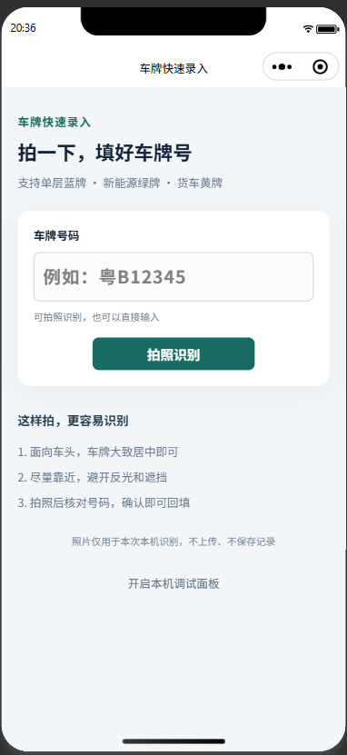

# wechat-plate-ocr

车牌快速录入 · 微信小程序端侧 OCR 示例

基于 **微信原生小程序、TypeScript 和 VisionKit OCR** 的车牌拍照录入示例。

对准车牌拍照，在手机端识别文字，经号码提取与校验后，核对并回填输入框。项目不需要自建 OCR 后端，也不需要单独配置第三方 OCR 密钥。

> 这是一个功能与调试流程示例。VisionKit 使用通用 OCR，当前尚未完成统一样本集的准确率评测；号码符合格式也不代表每一位都识别正确，使用时需要人工核对。

## 界面预览



## 功能

- 覆盖大陆单层蓝牌、单层货车黄牌、新能源绿牌号码规则，兼顾小型和大型新能源车牌。
- 后置摄像头拍照、补光开关、重拍、手动输入和结果确认。
- 取景框只提示大致位置，首次识别保留框外余量，失败后扩大区域并用全图兜底。
- 支持同一行相邻 OCR 分片拼接，保留疑似文字供人工修改，不自动替换 `O/0`、`I/1`。
- 显示实际送入 OCR 的图像，支持同一照片旋转后重新识别。
- 提供本机调试面板，console 打印原始 OCR 内容、事件时间和号码过滤原因。
- 应用代码不上传照片、不保存车牌历史记录；确认结果只保留在当前页面。

暂不包含双层黄牌、特殊号牌、相册入口、自动连续扫描、自动车牌颜色分类、记录列表和业务后端。

## 快速开始

### 1. 准备环境

- 微信开发者工具，以及用于预览/真机调试的 Android 或 iPhone。
- 自己的小程序 AppID。仓库中的项目 AppID 不作为公共测试账号使用。
- 建议使用 Node.js 22 或更高版本，运行依赖安装、类型检查和自动测试。
- 开发配置使用微信基础库 `3.17.6`；运行时还会检测 VisionKit OCR 能力，不能只按基础库版本判断设备是否可用。

### 2. 安装开发依赖

在项目根目录执行：

```sh
pnpm install
```

也可以使用 npm：

```sh
npm install
```

项目附带 `pnpm-lock.yaml`，优先使用 pnpm 复现依赖。依赖仅用于类型检查和测试，小程序没有运行时 npm 依赖，**无需在开发者工具中执行“构建 npm”**。

### 3. 导入并运行

1. 在微信开发者工具中导入仓库根目录，而不是 `miniprogram` 子目录。
2. 在导入配置中填写自己的 AppID；如果使用了仓库中的配置，请替换 `project.config.json` 的 `appid`。
3. 开发者工具通过已配置的 TypeScript 编译插件编译源码。
4. 点击“预览”或“真机调试”，在手机微信中打开并授权摄像头。

模拟器可用于检查页面和编译情况，不能代替真机测试相机和 OCR。当前微信或设备不支持识别能力时，页面会提示并保留手动输入。

### 4. 拍照录入

```text
拍照识别 → 车牌大致居中 → 点击拍照 → 核对/修改号码 → 确认使用
```

无需让车牌填满或贴合取景框。取消拍摄或取消确认不会覆盖已填写的号码；识别失败可以重拍或手动输入。如果预览中的文字方向不正确，点击“照片顺时针旋转 90° 再识别”。

相机授权通过 `wx.authorize({ scope: 'scope.camera' })` 在运行时请求，**不在 `app.json.permission` 中声明 `scope.camera`**。拒绝授权后可以通过页面的“相机权限设置”入口重新开启。

## 调试识别效果

**console 始终输出 OCR 原始内容，无需开启调试面板。** 在开发者工具的 Console 或真机调试日志中搜索：

```text
[plate-ocr]
```

日志依次包含各轮图像尺寸与裁剪参数、`runOCR` 调用、`addAnchors` / `updateAnchors` 原始返回（含文字与坐标）、结束原因，以及候选提取和拒绝原因。

在首页点击“开启本机调试面板”，然后重新拍照，可以对照原图、切换每轮实际输入图，并查看事件详情。图像和面板数据保留在当前页面内存中，重拍、取消或离开页面时清理；console 中已经打印的日志由调试工具管理。

详细排查方法见 [调试与测试](docs/DEBUGGING.md)。

## 检查与测试

```sh
pnpm typecheck
pnpm test
```

npm 对应命令为 `npm run typecheck` 和 `npm test`。

当前包含 **35 项自动测试**，覆盖号码规则、相邻分片、疑似结果、裁剪、旋转、异步取消、超时、全图兜底、console 输出与确认回填。TypeScript 严格检查及本地微信开发者工具 WXML/WXSS 编译已通过。

自动测试使用模拟的相机和 VisionKit 接口，验证程序行为，不代表真实设备的 OCR 准确率。实测方法和记录表见 [调试与测试](docs/DEBUGGING.md#真机效果记录)。

## 项目结构

```text
miniprogram/
  pages/index/          拍照、输入、确认与调试页面
  services/vision-ocr.ts VisionKit 会话、重试和日志
  utils/plate.ts        号码规范化、候选提取和人工核对建议
  utils/crop.ts         预览坐标到照片裁剪区域的映射
  utils/image-rotation.ts  旋转尺寸与矩阵
  app.*                 小程序入口与全局样式
tests/                  Node 原生自动测试
docs/                   实现说明与手测指南
typings/index.d.ts      应用自定义类型
project.config.json     微信开发者工具项目配置
```

模板遗留的 `pages/logs` 未注册到页面路由，`typings/types` 也不参与当前编译；实际微信 API 类型来自开发依赖 `miniprogram-api-typings`。

实现与可调参数见 [实现说明](docs/IMPLEMENTATION.md)。

## 已知限制

- 通用 OCR 在省份汉字、反光、倾斜、模糊、小车牌以及字母/数字混淆场景中可能出错，所有结果均需核对。
- 裁剪使用居中 cover 预览映射，不同机型的预览/成像差异仍需真机验证。调试面板展示真实输入，全图兜底降低裁剪偏移导致的漏识别。
- EXIF 方向仅在可从宽高判断的情况下自动矫正；无法判断的旋转或镜像不作盲目处理，可手动旋转后重试。
- 每轮等待上限为 8 秒，三轮无有效结果时最多约 24 秒；随时可以取消。有效结果通常提前结束收集，实际耗时以手机测试为准。

## 参考

- [微信官方小程序示例：静态图片 OCR](https://github.com/wechat-miniprogram/miniprogram-demo/tree/master/miniprogram/packageAPI/pages/ar/photo-ocr-detect)
- [微信官方小程序 API 类型定义](https://github.com/wechat-miniprogram/api-typings)
